<a href="https://shravanjois.in"><picture><source media="(max-width: 640px)" srcset="assets/hero-mobile.svg"></picture></a>

Three years taking Generative AI and agentic systems from proof of concept to production. At TietoEvry: a LangGraph multi-agent AI-SDLC framework, enterprise agents on Microsoft Copilot Studio and Microsoft 365 Copilot, a RAG clinical notes summariser, and an ML + LlamaIndex fraud anomaly engine. 1st prize, TietoEvry TechUtsav 2025, for EVA (Digital Human), the AI-SDLC framework and enterprise GenAI capability demos.


## `$ systems --list`

<table width="100%"><tr><td width="50%" valign="top"><a href="https://shravanjois.in/work/ai-sdlc"></a></td><td width="50%" valign="top"><a href="https://shravanjois.in/work/eva"></a></td></tr><tr><td width="50%" valign="top"><a href="https://shravanjois.in/work/helpdesk"></a></td><td width="50%" valign="top"><a href="https://shravanjois.in/work/whatsapp-assistant"></a></td></tr><tr><td width="50%" valign="top"><a href="https://shravanjois.in/work/clinical-notes"></a></td><td width="50%" valign="top"><a href="https://shravanjois.in/work/ev-charging"></a></td></tr></table>

## `$ play intro.mp4`

<a href="https://shravancode7-oss.github.io/#intro">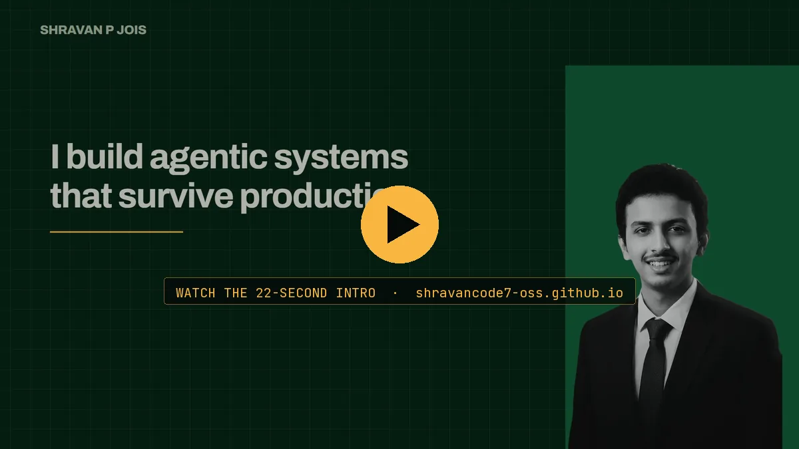</a>

22 seconds, plays on the <a href="https://shravancode7-oss.github.io/#intro">dossier page</a> · <a href="https://shravanjois.in">Case studies with measured results at shravanjois.in</a>

## `$ git log --career`


## `$ cat stack.txt`

**Agentic AI**

           

**Frameworks**

      

**LLMs**

    

**Microsoft AI**

     

**Cloud and LLMOps**

      

**Vector and data**

     

**Development**

      

**AI developer tools**

   

## `$ ls certs/`

<b>8 certifications</b> · Anthropic, Microsoft, Verzeo

- **Anthropic**, Oct 2026: Claude Code in Action · Claude Code 101 · Claude Platform 101 · Introduction to Claude Cowork · AI Fluency: Framework and Foundations · Claude 101
- **Microsoft**, Oct 2026: GitHub Copilot Fundamentals, Part 1 and 2
- **Verzeo**, Jan 2022: Internship Program: Artificial Intelligence

## `$ ping shravan`

Open to AI Engineer, Generative AI and Agentic AI roles. If you are building with AI, I would like to hear about it.

