## 01 · Who

- Three years taking Generative AI and agentic systems from proof of concept to production.
- At TietoEvry: a LangGraph multi-agent AI-SDLC framework, enterprise agents on Microsoft Copilot Studio and Microsoft 365 Copilot, a RAG clinical notes summariser, and an ML + LlamaIndex fraud anomaly engine.
- 1st prize, TietoEvry TechUtsav 2025, for EVA (Digital Human), the AI-SDLC framework and enterprise GenAI capability demos.

## 02 · What I build

| **01 · Agentic systems** | **02 · Retrieval (RAG)** | **03 · Enterprise copilots** |
| :-- | :-- | :-- |
| LangGraph · MCP · CrewAI · tool calling · guardrails | LangChain · LlamaIndex · ChromaDB · Pinecone · evals | Copilot Studio · Microsoft 365 Copilot · Graph API · Adaptive Cards |

## 03 · Systems I have shipped

<table width="100%"><tr><td width="50%" valign="top"></td><td width="50%" valign="top"></td></tr><tr><td width="50%" valign="top"></td><td width="50%" valign="top"></td></tr><tr><td width="50%" valign="top"></td><td width="50%" valign="top"></td></tr></table>

## 04 · By the numbers

## 05 · Stack

**Agentic AI**

           

**Frameworks**

      

**LLMs**

    

**Microsoft AI**

     

**Cloud and LLMOps**

      

**Vector and data**

     

**Development**

      

**AI developer tools**

   

## 06 · Experience

| Role | Where | When | What |
| :-- | :-- | :-- | :-- |
| **Junior AI Engineer** | TietoEvry, Bengaluru, hybrid | Jul 2025 to present | LangGraph multi-agent systems, Copilot Studio and Microsoft 365 Copilot agents, RAG clinical notes summariser, ML + LlamaIndex fraud anomaly engine, prompt and evaluation standards for the team. |
| **Associate Engineer** | Plugeasy Technologies, Remote | Apr 2024 to Jun 2025 | Core EV charging backend (Python, FastAPI), OCPP 1.6 and OCPI, REST APIs for web, mobile and IoT charge points, MongoDB design and AWS deployment. |
| **AI and Python Engineering Intern** | Verzeo, Remote | Sep 2021 to Oct 2021 | ML pipelines and computer vision workflows, Python backend services. |

B.E. Electronics and Communication Engineering, JNNCE Shivamogga, 2023.

## 07 · Certifications

- **Anthropic**, Oct 2026: Claude Code in Action · Claude Code 101 · Claude Platform 101 · Introduction to Claude Cowork · AI Fluency: Framework and Foundations · Claude 101
- **Microsoft**, Oct 2026: GitHub Copilot Fundamentals, Part 1 and 2
- **Verzeo**, Jan 2022: Internship Program: Artificial Intelligence

## 08 · Where

AI Engineer first. Web development is my hobby. If you are building with AI, I would like to hear about it.

    

